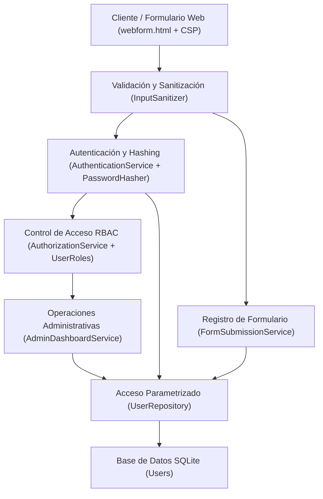

# SafeVault

**SafeVault** es una aplicación en **.NET 10** diseñada bajo prácticas de codificación segura para la gestión de usuarios, credenciales y control de acceso. El proyecto integra tres etapas progresivas de seguridad:

1. **Validación de entradas y consultas seguras** (`Actividad 1`): endurecimiento del formulario web, validación estricta con *allowlists*, prevención de XSS e inyección SQL mediante consultas parametrizadas.
2. **Autenticación y autorización RBAC** (`Actividad 2`): hashing de contraseñas con sal mediante **BCrypt**, verificación segura de credenciales y control de acceso basado en roles (`admin` y `user`).
3. **Auditoría, depuración y pruebas de ataque** (`Actividad 3`): remediación de XSS almacenado, sanitización de URLs y contenido de usuario (UGC), límites de 72 bytes UTF-8 en BCrypt, protección contra ReDoS y bloqueo de *path traversal* en rutas.

---

## Tecnologías y dependencias

| Componente | Tecnología / Paquete | Versión | Uso en SafeVault |
| :--- | :--- | :--- | :--- |
| Plataforma | .NET / C# (`net10.0`) | 10.0 | Biblioteca principal y pruebas unitarias con `Nullable` habilitado y `[GeneratedRegex]` |
| Base de datos | `Microsoft.Data.Sqlite` | 11.0.0 | Persistencia relacional y SQLite `:memory:` con sentencias parametrizadas |
| Criptografía | `BCrypt.Net-Next` | 4.2.0 | Hashing de contraseñas con sal aleatoria (factor de trabajo 11) |
| Pruebas | `NUnit` / `NUnit3TestAdapter` | 4.3.2 / 5.0.0 | Suite de pruebas unitarias, seguridad y simulación de ataques |
| SDK de pruebas | `Microsoft.NET.Test.Sdk` / `coverlet.collector` | 17.14.0 / 6.0.4 | Descubrimiento, ejecución y recolección de cobertura |
| Frontend base | HTML5 + CSP (`webform.html`) | — | Validación en cliente (`pattern`, `required`, longitudes) y cabecera `Content-Security-Policy` |

---

## Arquitectura y estructura del proyecto

```text
safevault/
├── README.md
├── SECURITY_AUDIT_SUMMARY.md
├── SafeVault.slnx
├── actividad-codigo-seguro-copilot.md
├── database.sql
├── webform.html
├── src/
│   └── SafeVault/
│       ├── SafeVault.csproj
│       ├── Data/
│       │   └── UserRepository.cs
│       ├── Models/
│       │   ├── AuthenticatedUser.cs
│       │   └── User.cs
│       ├── Security/
│       │   ├── AuthorizationService.cs
│       │   ├── InputSanitizer.cs
│       │   ├── PasswordHasher.cs
│       │   └── UserRoles.cs
│       └── Services/
│           ├── AdminDashboardService.cs
│           ├── AuthenticationService.cs
│           └── FormSubmissionService.cs
└── Tests/
    ├── SafeVault.Tests.csproj
    ├── TestAuthenticationAndAuthorization.cs
    ├── TestInputValidation.cs
    └── TestSecurityAuditFixes.cs
```

### Flujo de seguridad por capas



### Responsabilidades de los módulos

- **`Models/`**:
  - `User`: entidad persistida (`UserId`, `Username`, `Email`, `Role`, `PasswordHash`).
  - `AuthenticatedUser` y `AuthResult`: proyección segura para respuestas de autenticación sin exponer el hash de contraseña.
- **`Security/`**:
  - `InputSanitizer`: validación estricta de `username` (`^[a-zA-Z0-9_.-]{3,50}$`), validación de `email` con `MailAddress` y reglas anti-inyección, codificación HTML (`WebUtility.HtmlEncode`), sanitización de UGC (`SanitizeUserContent`) y validación segura de URLs (`SanitizeUrl`).
  - `PasswordHasher`: reglas de complejidad de contraseña, límite máximo de 72 bytes UTF-8 para BCrypt, `HashPassword` y `VerifyPassword`.
  - `UserRoles` y `AuthorizationService`: definición de roles (`admin`, `user`), validación de permisos y protección de rutas *fail-closed* con rechazo de rutas malformadas o *traversal*.
- **`Data/`**:
  - `UserRepository`: operaciones CRUD y búsqueda sobre SQLite utilizando `SqliteParameter`, escape de comodines `LIKE` (`ESCAPE '\'`) y validación de términos de búsqueda.
- **`Services/`**:
  - `FormSubmissionService`: valida envíos de registro, captura colisiones de unicidad (`SqliteErrorCode == 19`) y devuelve `SafeDisplayUsername` codificado para HTML.
  - `AuthenticationService`: registro con hashing BCrypt y `Login` con verificación *dummy* ante usuarios inexistentes para reducir diferencias de tiempo.
  - `AdminDashboardService`: panel administrativo (`GetAdminDashboard`) y asignación de roles (`AssignRole`) restringidos al rol `admin`, codificando salidas HTML por defensa en profundidad.

---

## Capas de seguridad y vulnerabilidades corregidas

Durante la implementación y la auditoría posterior (documentada en detalle en [SECURITY_AUDIT_SUMMARY.md](./SECURITY_AUDIT_SUMMARY.md)) se mitigaron las siguientes amenazas y brechas:

1. **Inyección SQL (SQLi) y consultas apiladas**:
   - Todas las consultas en `UserRepository` utilizan parámetros (`@Username`, `@Email`, `@PasswordHash`, `@Role`, `@Pattern`, `@UserId`) sin concatenación de SQL.
   - `SearchUsers` escapa `\`, `%` y `_` mediante `ESCAPE '\'`, rechaza bytes nulos (`\0`) y limita la búsqueda a 100 caracteres.
   - Las pruebas simulan payloads como `' OR '1'='1`, `admin'--`, `'; DROP TABLE Users; --`, `' UNION SELECT ...` y `'; UPDATE Users SET Role='admin' WHERE 1=1; --` confirmando que no hay filtración de datos ni escalamiento de privilegios.
2. **XSS reflejado, almacenado, en UGC y en URLs**:
   - `AdminDashboardService.GetAdminDashboard` codifica `Username` y `Email` con `InputSanitizer.SanitizeForHtml` para neutralizar payloads almacenados en base de datos heredada o comprometida.
   - `SanitizeUserContent` elimina bytes `\0` y caracteres de control no permitidos, normaliza saltos de línea a `\n` y codifica caracteres HTML.
   - `SanitizeUrl` permite únicamente rutas relativas de barra simple (`/ruta`) o URIs absolutos `http://` y `https://`, bloqueando `javascript:`, `vbscript:`, `data:text/html` y URLs protocol-relative (`//...`).
   - `webform.html` incluye `<meta http-equiv="Content-Security-Policy" ...>` con `script-src 'none'`.
3. **Denegación de servicio por expresiones regulares (ReDoS)**:
   - Todas las expresiones `[GeneratedRegex]` en `InputSanitizer` fijan `matchTimeoutMilliseconds: 250`.
4. **Truncamiento silencioso de 72 bytes en BCrypt y enumeración de usuarios**:
   - `PasswordHasher` restringe las contraseñas a un máximo de **72 bytes UTF-8** en `ValidatePasswordStrength`, `HashPassword` y `VerifyPassword`, evitando colisiones por truncamiento silencioso de BCrypt (incluidos caracteres multibyte).
   - `AuthenticationService.Login` ejecuta una verificación BCrypt contra un hash *dummy* cuando el usuario no existe o el formato es inválido y devuelve siempre el mensaje genérico `"Invalid username or password."`.
5. **Evasión de rutas RBAC y *path traversal***:
   - `AuthorizationService.AuthorizeRoute` aplica denegación por defecto (*fail-closed*) para rutas desconocidas y rechaza secuencias `..`, `\`, `//`, `%2e`, `%2f`, `%5c` y caracteres de control incluso para cuentas `admin`.

---

## Cómo compilar y ejecutar las pruebas

### Requisitos previos

- [.NET 10 SDK](https://dotnet.microsoft.com/download) (`10.0.x`)

### Comandos

```bash
# Restaurar dependencias y compilar la solución
dotnet restore SafeVault.slnx
dotnet build SafeVault.slnx

# Ejecutar toda la suite de pruebas NUnit
dotnet test --verbosity normal
```

### Cobertura de pruebas verificada

La suite ejecuta **45 pruebas unitarias** en NUnit (0 fallidas, 0 omitidas):

- `Tests/TestInputValidation.cs` (**15 pruebas**): validación de formularios, rechazo de cargas SQLi/XSS, codificación HTML y escape de comodines `LIKE`.
- `Tests/TestAuthenticationAndAuthorization.cs` (**18 pruebas**): registro con hashing BCrypt, rechazo de contraseñas débiles y roles inválidos, inicio de sesión seguro, control de acceso por ruta y protección del panel administrativo.
- `Tests/TestSecurityAuditFixes.cs` (**12 pruebas**): simulación de escalamiento SQLi, rechazo de `\0`/términos sobredimensionados en búsqueda, neutralización de XSS almacenado en panel administrativo, sanitización de UGC/URLs, límite de 72 bytes UTF-8 en BCrypt y bloqueo de *path traversal* en rutas RBAC.
